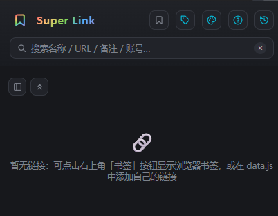

# Super Link (Browser Extension)

**A powerful bookmark tool · Manage all your bookmarks in one place.** Links and groups are initially defined in `data.js`, with **right-click management** — edit / delete links, rename groups, add links (auto-persisted, browser bookmark changes sync both ways), group tab navigation, fuzzy search, dark / light mode, multi-column layout, one-click account & password copy, and more.

Built on Chromium's Manifest V3 standard. Works directly in **Chrome, Edge** and other common Chromium-based browsers (Brave, Opera, 360 Speed, QQ Browser, etc.) with no code changes required.

<p align="center">
  
</p>

> 📖 [简体中文文档 (Chinese Documentation)](README.md)

***

## 1. Features

| Feature | Description |
| ------- | ----------- |
| Group tab navigation | Tabs divided by custom groups (add groups in data.js yourself); click a tab to show only its links |
| Fuzzy search | Filter by name / URL / note / group name / account & password; space-separated multi-keyword AND queries, case-insensitive |
| Open on click | Regular items (PC) open in a new tab on click |
| Copy link | Copy icon on every card copies the link with a "Copied" toast; WeChat H5 items copy on card click (green bar on the left) |
| Account & password copy | Items with accounts show account/password chips — click to copy, hover to peek |
| To top / bottom | Colorful gradient capsule at the bottom after scrolling: left half back to top, right half to bottom |
| Theme color | Palette button with 8 presets + custom color picker, applied instantly and remembered via localStorage |
| Dark / light mode | Follow system (reacts to system changes live) / light / dark — all remembered |
| Browser bookmarks | 🔖 toggle in the header reads browser bookmarks: folders become tabs, bookmarks become items |
| Help page | ❓ button opens `help.html` in a new tab |
| Browser history | 🕘 button opens the browser history page (Chrome/Edge aware) |
| Launch mode | Configure what the toolbar icon opens: side panel (default) / popup / standalone window (800px wide by default, remembers last size); applies instantly and survives restarts |
| Group type icons | Group tabs & titles show type icons (bookmark groups 📁 folder / built-in groups 🔗 link); toggle via header button |
| Multi-column layout | 1–8 columns in side panel / standalone window modes (popup is fixed single column) |
| Category layout | Side panel mode supports top-bottom (default) or left-right layout (category column on the left, independent scrolling) |
| Category area toggle | Button at the top-left of the content area hides / shows the category area to give content full width |
| Site favicon | Cards show the site favicon before the name (read from browser cache, zero network requests); hidden on failure |
| Right-click edit / delete | Right-click a card to edit its name / URL or delete it (two-step confirm); changes persist, bookmark items write back to browser bookmarks |
| Right-click group actions | Right-click a group title to rename the group or add a link; bookmark folder changes write back to browser bookmarks |
| Drag & drop sorting | Drag cards to reorder or move them between groups (with insert indicator); bookmark moves write back to bookmarks |
| Group collapse | Click a group title to expand / collapse it; one-click collapse / expand all from the content toolbar |
| Tab bar collapse | "Expand / collapse" button on the tab bar with smooth animation and hidden-tab count (e.g. "Expand +3") |
| Platform badge | "PC" badge = open on desktop; "WeChat H5" badge = copy link to open inside WeChat (green bar on the left) |

***

## 2. Project Structure

```
SuperLink/
├── manifest.json    # Extension config (Manifest V3)
├── popup.html       # Popup page structure
├── popup.css        # Popup styles (light & dark themes)
├── popup.js         # Rendering / tabs / search / copy / open / bookmark logic
├── background.js    # Service Worker (open mode, context menu, side panel)
├── data.js          # ★ Link data (groups + colors + links, maintained here)
├── help.html        # Help page (opens in a new tab)
├── sidepanel.html   # Side panel page (shares popup.js/css)
├── docs/            # Preview screenshots
├── icons/           # Extension icons (16 / 48 / 128)
├── LICENSE          # Custom non-commercial license
├── README.md        # Chinese documentation
└── README_EN.md     # English documentation
```

***

## 3. Installation

### 3.1 Browser Compatibility

| Browser | Supported | Extensions page |
| ------- | --------- | --------------- |
| Chrome | ✅ | `chrome://extensions/` |
| Edge | ✅ | `edge://extensions/` |
| Brave | ✅ | `brave://extensions/` |
| Opera | ✅ | `opera://extensions/` |
| 360 Speed | ✅ | `se://extensions/` |
| QQ Browser | ✅ | via App Center |
| Firefox | ❌ | Not adapted (Chromium-only) |

The installation flow is identical across browsers — only the extensions page address differs.

### 3.2 Chrome

1. Open `chrome://extensions/`
2. Enable **Developer mode** (top-right)
3. Click **Load unpacked**
4. Select the **`SuperLink`** folder (the directory containing `manifest.json`)
5. "Super Link" appears in the extension list — done

### 3.3 Edge

1. Open `edge://extensions/`
2. Enable **Developer mode** (left sidebar)
3. Click **Load unpacked**
4. Select the **`SuperLink`** folder — done

### 3.4 Other Chromium Browsers (Brave / Opera / 360 Speed / QQ)

Same as Chrome: open the extensions page → enable Developer mode → Load unpacked → select the `SuperLink` folder.

### 3.5 Launch Mode (Side Panel / Popup / Standalone Window)

Click the **palette button** and choose what the toolbar icon opens (requires Chrome/Edge 116+):

* **Side panel** (default): the icon opens the extension as a docked side panel
* **Popup**: the icon opens the popup
* **Standalone window**: the icon opens a floating window (800px wide by default, remembers the last size)

Settings apply immediately (the service worker calls `setPanelBehavior` / `setPopup` again) and survive browser restarts. You can also **right-click the toolbar icon → "Open Super Link in side panel"** at any time.

***

## 4. Adding / Maintaining Links

All groups and links are defined in **`data.js`**. After editing, reload the extension in the extensions page to apply.

### 4.1 Data Structure

```js
// "All" tab config (name + color)
const ALL_TAB = { name: '全部', color: '#6a8dff' };

const LINK_GROUPS = [
  {
    group: 'Tools',                 // group name (also a search field)
    color: '#6a8dff',               // group color (tab dot + title bar)
    items: [
      {
        name: 'Example Site',       // item name (required, max 20 chars shown)
        platform: 'pc',             // 'pc' desktop | 'wechat' WeChat H5 | null (optional)
        url: 'https://example.com/',// link (required)
        note: 'Some note',          // optional note, shown as an orange bar
        accounts: [                 // optional account list
          { label: 'User', username: 'user', password: 'pass' }
        ]
      }
    ]
  }
];
```

### 4.2 Field Behavior

| Field | Value | Behavior |
| ----- | ----- | -------- |
| `platform` | `'pc'` or `null` | Click opens the link in a new tab |
| `platform` | `'wechat'` | Click copies the link only (green bar marker) |
| `accounts` | `[]` | No account row rendered |
| `accounts` | has items | Account chip (plain) + password chip (••••••), click to copy |

### 4.3 Editing at Runtime

Right-click a card to edit its name / URL or delete it; right-click a group title to rename the group or add a link. Built-in edits persist in extension storage (`data.js` is only the initial template); bookmark items write back to browser bookmarks.

***

## 5. Browser Bookmarks

1. Toggle the 🔖 button in the header to merge browser bookmarks into the list
2. Every bookmark **folder** becomes a tab; bookmarks inside become items
3. Nested folders are named by path (`Work/Admin`), so they never clash with built-in groups; empty folders are ignored
4. Bookmark items support search and count toward the "All" tab
5. Toggle state is remembered via localStorage

> After updating the extension, reload it in the extensions page once — the browser may ask to confirm the new "read bookmarks" permission.

***

## 6. Notes

1. Groups without a `color` field fall back to the default blue
2. Hover the •••••• password chip to peek the plain password
3. Firefox is not supported (Manifest V3 / `chrome.*` APIs)

***

## 7. Open Source Notice & License

> This project is **for learning and communication purposes only. Commercial use is NOT permitted.** See [LICENSE](LICENSE) for the full terms.

* Refactored from a personal internal tool and open-sourced for learning and technical sharing
* Free to use, modify and redistribute **for non-commercial purposes** — keep this notice when redistributing, and do NOT use it commercially (including but not limited to paid distribution, integration into commercial products, paid training, etc.)
* The repository contains **no company information, internal network addresses or credentials**; if you find anything suspicious, please open an Issue
* All data (links, edits, preferences) stays in your browser (localStorage / `chrome.storage`) — **nothing is uploaded to any server**
* If you build upon this project, please credit the original work and apply the same non-commercial restriction

License: **Custom Non-Commercial License** (see [LICENSE](LICENSE))

***

## 8. Version History

The full version history (v1.0.0 → latest, in Chinese) is available in the [Chinese README](README.md#7-版本迭代记录). Highlights:

* **v1.14 – v1.17**: right-click edit / delete / rename / add (with persistence & bookmark write-back), layered Esc closing, instant+smooth scrolling fixes
* **v1.10 – v1.13**: link name truncation, to-top/to-bottom capsule, favicon display, bookmark-style icons, standalone window title fix
* **v1.8 – v1.9**: left-right layout scroll & divider drag fixes, search-filtered category column, standalone window mode
* **v1.5 – v1.7**: smooth tab collapse with hidden count, favicon display, multi-column masonry, category layout switch, launch mode config
* **v1.0 – v1.4**: open-source initial release, branding, dark/light mode, group icons, multi-column layout, right-click management
